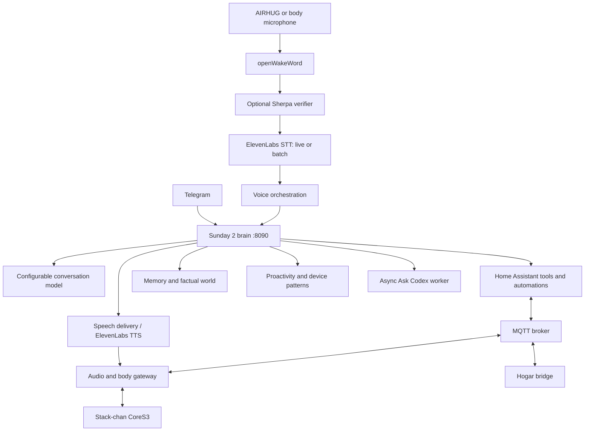

# Sunday

Sunday is a personal home assistant with a conversational brain, local home control, voice and Telegram interfaces, persistent memory, proactive behavior, and an expressive M5Stack Stack-chan body.

This private monorepo consolidates the working Raspberry Pi projects as of **11 November 2026 (Asia/Kolkata)**. It is an operational source snapshot with configuration examples, not a ready-to-install public distribution. Live databases, personal memories, credentials, recordings and deployment histories are deliberately absent.

## System at a glance



## Repository map

| Directory | Contents |
|---|---|
| [`brain/`](brain/README.md) | Rebuilt Sunday 2 brain: conversation, tools, Telegram, memory, world model, proactivity, costs, automations, Codex jobs |
| [`voice/`](voice/README.md) | Pi voice loop: wake detection, verifier client, STT, voice-brain adapter, TTS and transitional workers |
| [`audio/`](audio/README.md) | Stack-chan gateway, AIRHUG/body microphone selection, MQTT controls and recovery |
| [`wake/`](wake/README.md) | Sherpa verifier, debug/alias/dataset services, pinned openWakeWord runtime and two deployed wake-model choices |
| [`body/`](body/README.md) | Production 2.7.5 firmware source and separately marked experimental display/recovery source |
| [`ha/`](ha/README.md) | Sunday conversation integration, dashboard exports and selected automation examples |
| [`deploy/`](deploy/README.md) | Reference systemd units, path mapping and installation notes |
| [`extras/`](extras/README.md) | Prompt editor, development bridge, debug UI, feelings UI, clip review and Fire TV helpers |
| [`docs/`](docs/ARCHITECTURE.md) | Architecture, features, security, testing and operational limitations |
| [`tools/`](tools/) | Offline export checks and a non-destructive installation-layout planner |

## Capabilities

- **Conversation:** voice and Telegram, tool orchestration, room context, concise presentation, conversation continuity and configurable reply models.
- **Fast control:** deterministic Fast Mode for supported device-command grammar, with conversational fallback.
- **Home control:** entity discovery/resolution, direct actions, native HA automation creation, phrase triggers, historical evidence and device notifications.
- **Memory:** inbox and consolidated memory, retrieval, explicit memory operations and wiki-backed memory modules. Exact active behavior depends on local configuration.
- **World and routines:** factual home state, presence context, sessions/durations and device-pattern analysis.
- **Proactivity:** policy-controlled event evaluation and delivery, with availability/attention constraints.
- **Body:** expressions, mood/sleep context, servo behavior, touch/proximity, light/battery telemetry and optional diagnostic dual-mic capture.
- **Operations:** stage timing/debug dashboards, cost categories, model selection, async Ask Codex investigation/fix jobs and delivery tracking.

See [the feature map](docs/FEATURES.md) for implementation locations.

## What is deployed versus experimental?

The live brain and voice code are copied into `brain/`, `voice/` and `audio/`. Their configuration/state is not copied.

The body's verified live version at export is **`sunday-face-2.7.5-dual-mic-test`**. The display feature was reverted. Its host projection service, `sunday-glance.service`, is disabled. `body/experimental-display/` contains the later **2.8.4 Wi-Fi recovery source**, built but **not flashed**. Do not mistake its higher version for the running firmware. See [firmware status](body/README.md).

This export does not change running services, firmware, devices or production directories.

## Setup overview

1. Clone the private repository and read [deployment notes](deploy/README.md).
2. Create separate Python environments for brain, voice, gateway and Sherpa dependencies. The current installation spans Python 3.13 environments; HA itself runs separately in a container.
3. Copy `brain/config.example.json` and `voice/config.example.json` to untracked `config.json` files and fill credentials locally. Configure the gateway's local secrets and firmware `secrets.h` separately.
4. Map the component directories to the legacy paths using the [layout planner](tools/local-layout.py). Many existing modules use absolute `/home/djpi/...` paths; a relocated checkout needs explicit path adaptation.
5. Install/configure HA, MQTT, audio devices and the desired providers. Import HA examples selectively, resolving your own entity IDs.
6. Start only the services appropriate to the deployment. Keep one voice-input owner and one Telegram polling owner.
7. Validate text/HA reads first, then microphone capture and physical device behavior. HA's assumed state is not physical confirmation.

There is intentionally **no automatic flashing, secret provisioning, automation execution or production service restart** in repository setup.

## Checks

```bash
python3 tools/check-export.py
python3 tools/check-python.py
# Install gitleaks separately; scan before any push:
gitleaks detect --source . --no-git --redact
```

Component tests are documented in [TESTING.md](docs/TESTING.md). Test suites with legacy absolute paths need the documented layout or test stubs; this consolidation does not claim a clean full-system CI run.

## Configuration and privacy

Credentials embedded in older code have been replaced with `REPLACE_ME`; examples use empty/local placeholder values. Provision real credentials locally. Never commit production `config.json`, `secrets.h`, `.env`, gateway keys, personal chats/memories, SQLite files, recordings, model-training datasets or raw request captures.

Tracked ONNX files are the deployed wake assets, not household recordings. Build outputs, firmware images, environments and downloaded large STT/TTS/Sherpa models are excluded. [Security notes](docs/SECURITY.md) explain the boundaries.

## Ownership and licensing

Commits are made under **karthik-veenam**, without co-author trailers. No new blanket license is assigned to this collection. Original third-party licenses and notices remain applicable; see [THIRD_PARTY.md](docs/THIRD_PARTY.md).
